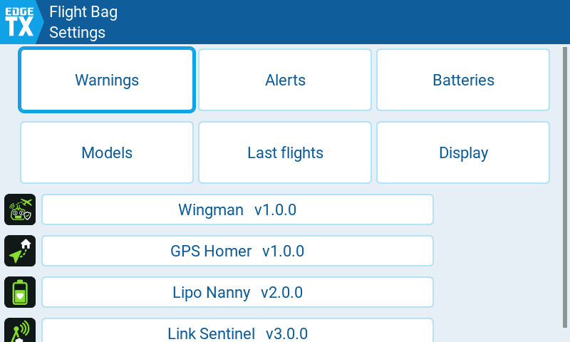
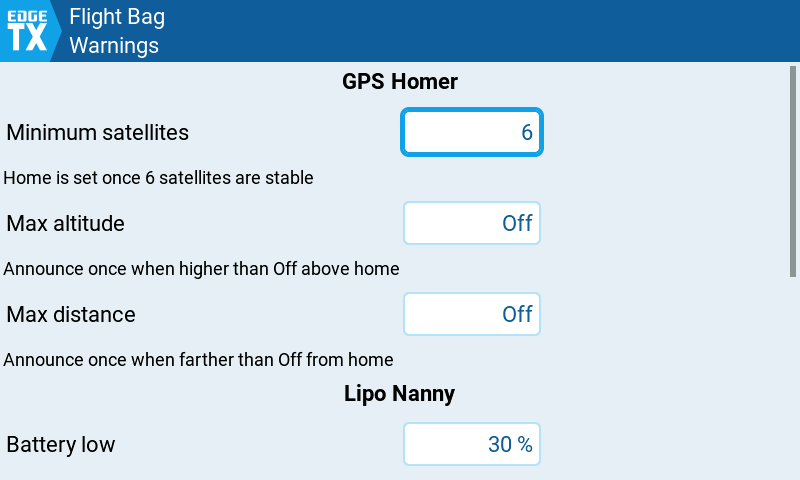

# edgetx-flight-bag


Flight Bag (EdgeTX UI) is **one settings tool** for [Lipo Nanny](https://github.com/Mariator-pro/edgetx-lipo-nanny), [ELRS Link Sentinel](https://github.com/Mariator-pro/elrs-link-sentinel), [GPS Homer](https://github.com/Mariator-pro/edgetx-gps-homer) and [Flight Wingman](https://github.com/Mariator-pro/edgetx-flight-wingman), built from EdgeTX's own controls. It looks and feels like the radio menus: toggles, choice lists, number fields, text fields with the on-screen keyboard, dialogs, touch and scrolling all come from EdgeTX.

[](LICENSE)
[](https://edgetx.org)
[](../../issues)
[](../../commits/main)

<p align="center">
  
  
</p>

---

## 📑 Table of Contents

- [📋 Compatibility](#-compatibility)
- [🎯 What is it for?](#-what-is-it-for)
- [🧰 Requirements](#-requirements)
- [📥 Installation](#-installation)
- [🧭 Pages](#-pages)
- [🛠️ Troubleshooting](#️-troubleshooting)
- [🤝 Contributing](#-contributing)
- [📄 License](#-license)

---

## 📋 Compatibility

> [!CAUTION]
> **Work in progress, not released yet.** So far the tool has been tested in the EdgeTX simulator only, not on a real radio. Feedback is very welcome, please [open an issue](../../issues).

| Component | Minimum Version | Tested On | Test Hardware |
|-----------|-----------------|-----------|---------------|
| EdgeTX    | v2.12.5         | current development build (simulator) | TX16S (480×272), TX16S MK3 (800×480) |

On older firmware the tool shows a notice instead of its pages. The drawn Flight Bag that comes with the four projects keeps working there (EdgeTX 2.11 or later).

---

## 🎯 What is it for?

Lipo Nanny, Link Sentinel, GPS Homer and Flight Wingman share one settings tool, Flight Bag. Each project ships it as a drawn tool that runs on EdgeTX 2.11. Flight Bag (EdgeTX UI) is a second form of it: the same settings, the same config files, but built from the controls of the EdgeTX menus instead of drawn by the script.

- **Sorted by topic, not by app:** Warnings, Alerts, Batteries, Models, Last flights and Display. A value used by several apps (for example a sound) is set once for all of them.
- **Native controls:** touch, rotary encoder and keys work as everywhere else in EdgeTX; battery names are typed with the on-screen keyboard on touch radios.
- **Only what you have:** the start page lists the installed apps and shows only the topics they need. A warning sign next to an app tells you what is still missing; tap the app for details, its files and resets.
- **Same data as the drawn tool:** both tools write through the apps' own logic, so you can switch between them at any time.

---

## 🧰 Requirements

- A **color-display radio** running **EdgeTX 2.12.5 or newer**.
- At least one of **Lipo Nanny, Link Sentinel, GPS Homer or Flight Wingman** installed. Flight Bag (EdgeTX UI) brings no app logic of its own; it finds every `/SCRIPTS/<NAME>/` folder with a `core.lua`.

---

## 📥 Installation

Copy the `src/` content 1:1 into the root of the SD card:

```
SCRIPTS/
├── TOOLS/
│   └── FLIGHTBAGX.lua      ← Tools menu entry "Flight Bag (EdgeTX UI)"
└── FLIGHTBAG/
    ├── apps.lua            ← shared with the drawn Flight Bag
    ├── *_model.lua         ← page logic, shared with the drawn Flight Bag
    └── LVGL/               ← the pages of this tool
```

`apps.lua` and the `*_model.lua` files are the same files the four projects ship with the drawn Flight Bag, so overwriting them is fine. Then open **SYS → Tools → Apps → Flight Bag (EdgeTX UI)**.

---

## 🧭 Pages

| Page | What you set there |
|---|---|
| **Warnings** | Thresholds of the apps (battery low and critical, minimum satellites, max altitude and distance, ...) |
| **Alerts** | Sounds and vibration, with a `Play` button per sound |
| **Batteries** | Battery profiles (name, manufacturer, chemistry, capacity, cells), packs with cycles, wear and purchase date, statistics |
| **Models** | Cells and parallel packs per model, battery assignment, telemetry sensors, Wingman's columns |
| **Last flights** | Last logged positions with a QR code for your phone's map app |
| **Display** | Display options of Wingman and Lipo Nanny |

Every row shows a short hint below it that follows the value. **Save** writes all apps at once; **Back** with unsaved changes asks `Discard changes?`. What each setting does is described in the [Flight Bag guide](https://github.com/Mariator-pro/edgetx-flight-wingman/blob/main/docs/flightbag.md) of Flight Wingman.

---

## 🛠️ Troubleshooting

- **"Flight Bag (EdgeTX UI) needs EdgeTX 2.12.5 or later":** Update EdgeTX, or use the drawn **Flight Bag** in the meantime.
- **A topic is missing on the start page:** None of the apps that use it is installed (Batteries needs Lipo Nanny, Last flights needs GPS Homer).
- **Warning sign next to an app:** Tap the app; the popup names the problem and offers `Create` or `Reset` for a missing or broken config.
- **"Save failed. Check SD card.":** The SD card is full or write protected.
- **"Script syntax error":** A file is missing or damaged. Copy the `SCRIPTS/` folders again.

---

## 🤝 Contributing

Found a bug or have an idea? Please [open an issue](../../issues). `apps.lua` and the `*_model.lua` files originate in [edgetx-flight-wingman](https://github.com/Mariator-pro/edgetx-flight-wingman); changes to them go there.

---

## 📄 License

Released under the [GNU General Public License v2.0](LICENSE).
